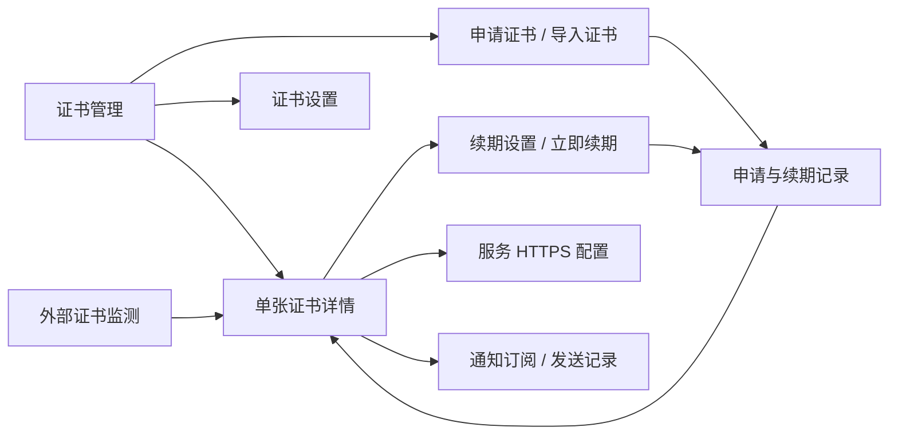

# 证书管理、续期与故障恢复重规划

日期：2026-11-17。状态：用户已授权执行，A/B/C 实现已落地；最终验证范围和外部联调边界见 [实施记录](SSL-MANAGEMENT-IMPLEMENTATION.md)。本文保留规划阶段的产品合同与历史问题；其中“现状”“尚未实现”和原验收清单描述的是实施前基线，不代表当前代码状态。

范围：证书管理、申请与续期记录、外部到期监测，以及它们依赖的 DNS 凭据、CA 认证、服务绑定、计划任务和通知入口。沿用 HomeWaf 品牌、Vue/Element Plus、共享 tokens 和当前路由，不进行全控制台导航重做。

## 1. 产品决定

1. **以证书为中心管理生命周期。** 在证书上查看有效期、使用范围、更新方式、续期状态和故障；从同一个对象发起续期、修改策略、查看结果。
2. **申请与续期记录负责过程与追溯。** 首次申请入口放回证书管理；记录页可以查看进度、错误和重试结果，不能承担续期策略管理。
3. **区分续期、部署、探测和通知。** 签发成功、写入证书库、更新服务、导出文件、远端检测、发送通知分别给出结果，避免一个“成功”掩盖后续失败。
4. **失败恢复是主要任务。** 证书行和详情直接回答“还会不会重试、何时重试、现在需要我做什么、通知发到哪里”，不能只显示“自动续期已开启”。

规划阶段交付为方案与核查证据。后续实施已调整页面和后台生命周期，未直接修改用户运行实例的证书或订阅；已实现的能力、实际测试和未验证项在实施记录中逐项列出。

## 2. 实施前问题与依据

| 已确认问题 | 证据 | 对用户的影响 |
| --- | --- | --- |
| 证书库只有新建、编辑、删除，操作列排第一，域名排在数个日期列之后，序列号和 ID 占主表宽度 | [证书列表](../../web/src/pages/waf/sslconfig/index.vue) | 找得到原始字段，找不到当前应处理的证书与动作 |
| 成功申请记录上提供“手动续期”，并打开另一套完整申请表 | [记录表](../../web/src/pages/waf/sslorder/OrderTable.vue)、[申请页](../../web/src/pages/waf/sslorder/index.vue) | 管证书需要先找历史订单；修改续期选项还要发起申请 |
| 续期表允许改服务、域名、CA，服务端又明确禁止这些变更 | [Submit](../../service/waf_service/waf_sslorder_submission.go) | 界面允许完成一个最终必定被拒绝的操作 |
| 自动续期开关存在 SslOrder，定时任务找服务最新成功订单；没有独立保存续期策略的接口 | [订单模型](../../model/sslorder.go)、[订单服务](../../service/waf_service/waf_sslorder.go)、[续期任务](../../waftask/task_ssl.go) | 历史记录与长期配置耦合，旧记录上的开关不能可靠代表当前策略 |
| 终态订单可删除；定时续期仍依赖成功订单里的申请配置和证书材料 | 同上；订单 DelApi 只阻止进行中任务删除 | 删除最新成功记录可能导致失去续期来源，或回退读取更早配置 |
| 证书返回绑定服务的展示字符串，没有稳定的证书→续期策略→任务关联 | [响应](../../model/response/waf_ssl.go)、[绑定汇总](../../service/waf_service/waf_sslconfig.go) | 不能用域名相同或列表第一条来拼出可信的“续期状态” |
| DNS 分组、凭据、CA 维护和 ZeroSSL 认证分散在申请页弹窗里 | [DNS 配置](../../web/src/pages/waf/sslorder/DnsProviderConfig.vue)、[ZeroSSL](../../web/src/pages/waf/sslorder/ZeroSSLAccount.vue) | 更换凭据要进入一次申请操作，且看不到影响哪些证书 |
| 外部检测使用无筛选条件的“搜索”；错误主要写控制台；把更新时间当主要时间 | [到期检测](../../web/src/pages/waf/ssl_expire/index.vue) | 读取失败、未检测、检测失败和真实过期不够清楚 |
| LastDetect 在任务中赋值但 Modify 未保存；ExpirationDay 对已过期返回绝对值，前端按正数着色 | [检测任务](../../waftask/task_ssl.go)、[检测服务](../../service/waf_service/waf_sslexpire_service.go)、[检测模型](../../model/sslexpire.go) | 可能出现已经过期却按剩余天数显示正常颜色，不能靠换列标题修复 |
| 证书库、检测列表的数据库 Find/Count 错误未向上返回；证书导入 Create 错误也未检查 | [证书服务](../../service/waf_service/waf_sslconfig.go)、[检测服务](../../service/waf_service/waf_sslexpire_service.go) | 前端即使有错误提示，也可能收不到真实失败 |
| “同步主机”只遍历旧 Hosts；nowcheck 触发全列表检测 | [SyncHostToSslCheck](../../waftask/task_ssl.go)、[检测 API](../../api/waf_sslexpire_api.go) | 不能宣称已同步全部原生服务，也不能把全局检测包装成单行检测 |

历史比较锚点 `52078dfc164a3cb60637f903ba9b630dc64d5f45` 不在本地对象库。本轮对照可用历史：`9f097f42` 的 DNS 能力、`f460dd9d` 的自动续期/幂等/日志、`390b1a5b` 的导航与表单调整、`f136b014` 的不可达代码清理、`deb42a57` 的证书编辑修复。当前导航和删除过的页面不作为不可改变的设计，也不因旧代码存在而恢复整套旧页面。

## 3. 现在失败会不会重试、会不会通知

以下结论来自代码和已有隔离测试，不代表已检查当前运行实例的配置或真实送达情况。

| 场景 | 当前行为 | 局限 |
| --- | --- | --- |
| 自动续期正常检查 | 默认每天 02:13，调度时区 Asia/Shanghai；域名默认提前 30 天，IP 默认提前 3 天 | 已保存的计划和阈值优先，不能把默认值当成每台实例的实际计划 |
| CA/DNS 续期失败 | 原成功订单仍保留；后续计划可再次从它创建续期任务 | 幂等键按来源订单 + UTC 日期，同一 UTC 日不重新提交该自动任务；没有失败后按分钟/小时退避的调度 |
| 证书已过期 | 定时任务跳过；现有续期提交也要求原证书未过期 | 当前需新建申请，不能声称会无限重试直到恢复 |
| 处理进程中断 | 90 秒无心跳显示异常，超过 10 分钟标记失败，允许人工重试 | 标记失败只写订单/日志，未进入普通续期失败的外部通知路径 |
| 普通申请/续期失败、签发后保存/绑定失败 | 生成系统日志及 OperatorMessageInfo，进入 operation_notice | 需启用“操作通知”订阅及渠道，并通过过滤/免打扰/频控；只订阅 ssl_expire 不够 |
| HTTP-01 前置条件不满足 | 跳过，写日志及 OpResultMessageInfo | 只推在线控制台，未走订阅渠道 |
| 自动提交阶段报错、执行 panic | 前者主要写运行日志；后者标记任务失败 | 未统一接入外部失败告警 |
| 续期成功但导出失败 | 有单独导出失败操作通知；续期仍可显示成功 | 需要在证书上持续显示“导出失败”，不能只依赖瞬时消息 |
| 外部通知发送失败 | 发送层记录失败日志 | 未见统一持久化投递重试；通知入队不等于渠道接收，更不等于用户已读 |

补充：operation_notice 当前默认严重级别为 info，普通续期失败也可能被“只接收警告及以上”的订阅过滤。消息队列是内存队列，进程退出可能丢失尚未投递的事件。代码证据见 [调度默认值](../../wafdb/schema_tasks.go)、[调度器](../../waftask/core_scheduler.go)、[提交/重试](../../service/waf_service/waf_sslorder_submission.go)、[执行器](../../wafenginecore/sslorder.go)、[队列分发](../../wafqueue/message_queue.go)、[通知事件](../../service/waf_service/waf_notify_event.go)、[通知发送](../../service/waf_service/waf_notify_sender.go)。

## 4. 信息架构与入口

保留“证书与 HTTPS”分组，按以下顺序排列：

| 主页面 | 沿用路由 | 唯一职责 | 主要动作 |
| --- | --- | --- | --- |
| **证书管理** | `/waf-host/wafsslconfiglist` | 当前证书、使用关系、更新方式、续期与故障恢复 | 申请证书；次要入口为导入证书、证书设置 |
| **申请与续期记录** | `/waf-host/wafsslOrderlist` | 每次执行的进度、结果、日志、历史 | 查看详情、对失败任务重试；不强造页面级主按钮 |
| **外部证书监测** | `/waf-host/wafsslExpirelist` | 域名:端口远端呈现的证书及检测结果 | 添加监测；次要入口为检查全部、从服务添加 |

“证书设置”是证书管理的次级页面，不再增设一个同级“续期中心”。DNS 凭据、CA 认证、实例默认策略在其中维护。通知渠道/订阅仍由“消息通知”管理，证书页显示覆盖摘要和带上下文的配置入口。管理控制台自己的 HTTPS 绑定仍归实例管理，证书详情只呈现它的使用关系。



旧路由、帮助链接、全局搜索和旧站点内的申请入口都要迁至同一任务组件。保留已有 `srcHostCode` 服务上下文。新详情、申请表、设置页使用可深链的次级路由；返回时恢复原服务、筛选、分页和滚动位置，返回地址仅允许应用内目的地。

## 5. 证书管理页

### 首屏与列表

页头为“证书管理”，主操作“申请证书”，次操作“导入证书”，普通链接“证书设置”。筛选区提供域名/名称搜索、有效性、更新方式和使用服务；“需要处理”是可点的筛选项，包含过期、近期到期且更新无保障、续期失败、部署/导出失败。数量由服务器按完整结果统计，不能用当前页拼总数。

主表控制为六列，顺序如下。使用日期、标签和行内提示，避免堆叠大统计卡片。

| 列 | 内容 |
| --- | --- |
| 证书 | 主域名，附加域名数量可展开，颁发者为次级信息；点击进入详情 |
| 有效性 | 有效/即将到期/已过期/尚未生效；到期日期与剩余时间 |
| 使用范围 | 服务名称、端口、绑定数量；区分已绑定、尚未配置 HTTPS、无绑定；不推断正在对外服务 |
| 更新方式 | HomeWaf 自动申请、外部文件同步、手动维护、来源待确认 |
| 续期与故障 | 当前执行状态，最近失败摘要，下次尝试时间；“续期设置”可直接到达 |
| 操作 | 按状态显示“立即续期”“查看进度”“重试”“替换证书”；更多菜单收纳次要/删除操作 |

“证书来源”和“当前更新方式”分开存储。手动导入的 Let's Encrypt 证书不会因为颁发者名称相同就具备自动续期能力；历史备份也不能直接判定为当前证书或自动删除。

以下为信息顺序线框，示例内容不是当前实例数据：

```text
证书管理                             [申请证书] [导入证书]  证书设置
搜索域名 / 服务      有效性 ▾   更新方式 ▾       需要处理

证书              有效性       使用范围        更新方式       续期与故障
nas.example.com   还剩 8 天     家庭 NAS:8443    HomeWaf       失败，等待重试
                  到期日期                     自动申请      DNS 查询超时
                                                             下次尝试 14:30
                                                             [续期设置] [重试]
```

### 单张证书详情

采用详情页，承载长期配置、使用范围和历史；不会打开一个包含所有功能的巨型弹窗。按“身份与状态 → 当前故障/下一步 → 续期策略 → 使用范围 → 文件设置 → 最近记录”的顺序自然滚动，不叠加第二层 tabs。

- 身份：全部域名/IP、有效期、颁发者；序列号、指纹、记录 ID 收入“证书信息”，保留复制能力。
- 故障：失败阶段、最近失败时间、连续失败次数、下次尝试、可执行的修复/重试动作。没有故障时不占据大块提示区域。
- 续期策略：开关、CA、验证方式、DNS 凭据分组、通知覆盖。显示当前生效值；点击“编辑续期设置”进入短表单，保存不发起 CA 请求。
- 使用范围：每个绑定服务、端口、配置状态及最近部署结果；管理端绑定独立标识。“配置 HTTPS”带服务上下文进入原生配置流程。
- 文件设置：完整保留自动加载开关、证书/私钥读取路径、证书/私钥导出路径和最近导出结果。折叠时仍显示启用状态与失败提示。现有 [CertificateEditor](../../web/src/pages/waf/sslconfig/CertificateEditor.vue) 的 PEM 导入、字段错误、草稿保护继续复用。
- 最近记录：最近一次成功及失败，可到记录页按证书过滤；完整日志不占据详情首屏。

导入证书显示“手动维护”或经确认的“外部文件同步”。需要转为 HomeWaf 自动更新时，动作叫“配置自动申请”：填写验证条件，签发并验证绑定成功后完成接管；保留原证书直至新版本可用。不是给任意 PEM 添加一个续期开关。

同一证书可被多个服务引用。续期作用于证书，部署结果按服务分别显示；不为每个引用服务重复向 CA 申请。更换 SAN/CA 属于重新申请，应保留旧证书并展示受影响绑定。切换更新方式要显式说明未来由谁更新，避免文件同步和 ACME 互相覆盖。

## 6. 申请证书、续期设置和立即续期

| 任务 | 输入与校验 | 提交语义 | 结果与恢复 |
| --- | --- | --- | --- |
| 申请证书 | ①服务、域名、邮箱；②CA、DNS/HTTP 验证与凭据；③自动续期、使用范围、通知覆盖。服务端验证完整条件 | “提交申请”创建任务；首次使用默认 DNS 验证、自动续期开启 | 进入任务详情；只收到受理时显示“等待处理”。失败保留配置并可修正重试；成功后进入证书详情 |
| 保存续期设置 | 自动开关、验证方式、DNS 分组、联系邮箱。证书身份和 CA 只读，更换另走重新申请 | “保存设置”只修改长期策略，不创建订单 | 保存后重读同一策略；失败留草稿，版本冲突显示差异并要求重读 |
| 立即续期 | 展示证书、域名、使用服务和本次采用的策略；不重复填写申请表 | “开始续期”使用服务端当前策略和稳定幂等 ID | 返回当前/新任务；已有运行任务时转到它；开关关闭也可手动执行一次，不自动开启长期策略 |
| 失败重试 | 展示失败阶段；使用可恢复的当前策略，记录策略版本 | “重试续期”或“重试更新服务”，标签准确 | 生成新的尝试记录并关联原故障；日志能追溯原配置与此次配置差异 |
| 导入/替换证书 | 文件或 PEM、私钥配对、使用范围 | 文件导入仅填草稿，“保存证书”才提交 | 沿用字段错误、保存重开、取消和部分导出失败行为 |

没有服务时保留草稿，允许在新标签页完成原生服务创建，再刷新并选择。DNS/ZeroSSL 凭据可在当前任务内打开同一份专用编辑器，保存后回到原表单并刷新状态；凭据保存属于已提交动作，取消申请不会撤销它。秘密只保留在内存，不写 localStorage/sessionStorage，不放入 URL。

首轮保留现有申请必须关联服务的约束；“仅申请到证书库、不关联服务”属于可扩展能力，当前后台不支持，不能用空服务 ID 假装打通。HTTP 服务申请成功后不自动改协议或启用监听，展示“证书已保存，待配置 HTTPS”。

关闭自动续期取消未来尚未领取的自动任务；已经进行中的签发不能许诺撤销。后端用策略版本和领取检查处理竞态，页面明确显示在途任务。更新绑定或手动替换证书时也要在部署前重查，避免旧任务覆盖用户的新证书。

## 7. 申请与续期记录页

列表以“时间、证书/域名、任务类型、执行结果、当前阶段、操作”为主，支持证书、服务、时间、首次申请/自动续期/手动续期/恢复、进行中/失败/完成筛选。

详情呈现：提交时配置快照 → 时间线与日志 → 签发/入库/各服务更新/导出结果 → 重试安排 → 通知投递结果。旧订单的 auto_renew 只能叫“提交时的续期选项”，不能当成当前开关。历史证书有效期标明“该次签发结果”，后续被替换不应抹去原成功事实。

成功记录操作为“查看当前证书”“查看日志”；失败记录可“重试”“处理原因”。不在记录页保留第二套续期设置表单。没有记录时引导“到证书管理申请证书”；无筛选结果提供清除筛选。

沿用进行中日志每 3 秒刷新、最近 500 条、密钥脱敏、旧日志可能不完整的提示。只在存在活动任务时轮询；切换任务取消旧请求，后台刷新失败保留旧数据并标记“状态更新失败”，不宣告任务结束。

历史删除保留原能力，但必须在续期配置及签发上下文已迁出之后才能删除其来源。迁移期间服务端保护仍被使用的记录并说明原因；所有阶段都阻止删除运行中任务。记录删除不取消策略、不删除证书，也不能消灭唯一的故障恢复线索。

## 8. 外部证书监测页

对象为“域名/IP + 端口”，位置包含 LAN 或公网；“外部”指网络握手观察，与库内 PEM 状态相区别。显示结果注明“从 HomeWaf 所在机器检测”，不宣称代表所有访客网络。

主表：目标 → 本次检测状态 → 远端到期时间 → 最近尝试/最近成功 → 错误与操作。状态区分未检测、检测中、正常、临近到期、已过期、连接/握手失败。最近一次失败时可以保留上次成功结果，但必须带“上次结果”标识，不能继续当成当前正常。

- 添加监测表单显示域名/IP、端口（默认 443），服务端校验并去重；删除文案为“移除监测”，明确不删除证书或停用服务。
- “检查全部”沿用现有全局任务；单行“重新检查”需要有作用域的后台能力后才能出现。
- “从服务添加”展示原生服务与保留的旧站点，先选目标并预览；后台只添加缺失目标，不覆盖用户已有监测项。
- 监测目标可链接相关证书/服务，但仅域名相同不足以证明当前远端正在用某个库内版本；确定版本一致需要后端返回指纹等握手证据。
- 通知入口是现有 ssl_expire 订阅；不得把添加监测设为自动续期的前置条件。

## 9. 证书设置与共享依赖

设置页采用有标题的三个区域，普通用户无需填写原始 JSON：

| 区域 | 维护内容 | 与当前申请的关系 |
| --- | --- | --- |
| DNS 验证凭据 | 服务商、具名分组、已配置字段、创建/更新、使用中的证书；HE 多域名字段和高级 SDK/文件认证保留 | 表单只选择或快捷维护；凭据存在不代表远端授权已验证 |
| 证书机构与账户 | CA 地址/备注；ZeroSSL API Key 或成对 EAB 认证 | 复用现有独立保存方式；CA 元数据保存和认证保存分别反馈 |
| 实例默认策略 | 实际检查计划/时区、续期阈值、重试规则、文件同步全局状态；通知覆盖摘要 | 计划任务/系统配置仍有唯一持久化来源，使用带上下文的编辑入口，不复制另一组默认值 |

完整保留 195 个 DNS 目录条目及可用性说明，manual 求解器仍不可用于无人值守申请。保留 DNS 传播检查选项及 HTTP-01 的公网 80 前提；DNS-01 不要求开放入站 80/443，IP 证书不能使用 DNS-01。

现有 sslhttp_check 实际控制异常挑战响应的日志提示，目标名称为“HTTP 挑战异常告警”，放在高级设置，不能再让“严格/宽松”暗示它能降低 CA 验证要求。

不恢复已清理的通用旧凭据页。分组重命名、删除等无当前入口的旧 API 先核实引用与使用场景；若新增管理动作，必须检查正在使用的证书、在途任务和权限，不能因为接口存在就直接展示。

## 10. 目标重试与通知策略

### 重试：建议默认值，尚未实现

正常到期检查沿用实例已有计划；失败重试由持久化的“下次尝试时间”驱动，不再依赖跨一个 UTC 日期。界面显示服务器计算的绝对时间和时区，不自行从默认 02:13 推算。

| 失败类型 | 建议恢复规则 | 用户看到 |
| --- | --- | --- |
| 暂时性网络超时、DNS 传播/服务商暂时异常 | 失败后依次等待 15 分钟、1 小时、4 小时，再每 6 小时；加少量抖动，单证书 24 小时内最多 6 次自动尝试 | 失败原因、已尝试次数、“将在…重试”、立即重试 |
| CA 限流 | 优先遵守 Retry-After/CA 返回的更晚允许时间；人工操作也不能绕过限流 | 最早可重试时间，等待原因 |
| 凭据拒绝、权限不足、缺少必要配置、HTTP 验证条件不满足 | 暂停提交 CA，进入“需要处理”；修复保存与“重试”是分开的动作 | 定位具体配置，显示“暂不重试，需…” |
| 执行进程失联或结果未知 | 恢复后核对租约、已有订单和已保存结果；确认可继续才接续，否则需人工确认结果 | “结果待核对”；不能把无心跳直接视为可重复签发 |
| 已签发但入库/绑定/导出失败 | 保存已有签发材料和阶段，只重试失败阶段；部署前复核绑定版本 | “证书已签发，某服务更新失败”或“导出失败”；不再次消耗签发额度 |
| 证书过期仍未恢复 | 不从管理列表消失。策略仍开启且条件有效时，用保存配置发起一次受控重新申请；仍遵守限流与重试预算 | “已过期，正在恢复”或明确人工处理原因；保持故障告警 |

上述间隔从上一次失败结束时计算。次数到预算时只是等待下一个允许窗口，不永久关闭用户的自动续期。首次申请失败保留人工重试；“自动续期”在首次签发并完成预定绑定后启动，提交确认中明确此边界。未知错误先核对阶段和远端结果，不能一律当成网络超时。已删除服务、用户解除绑定、关闭策略等是配置变化，不能用后台重试反向覆盖。

每次重试、策略修改、恢复结果写可追溯记录。重复点击、重启、多进程接管与计划检查同时发生，只能有一个有效尝试。旧成功证书在失败时继续保留；是否仍可服务由有效期、绑定和运行结果决定。

### 通知：复用消息通知系统，补齐事件和可靠投递

- 首次续期失败、配置阻塞、任务中断、签发后部署/导出失败必须产生结构化故障事件；包含证书 ID、任务 ID、服务范围、失败阶段、剩余有效期、下一次动作和安全的详情链接。
- 同一故障连续重试按证书/故障合并，首次立即提醒，仍未解决时做周期提醒；临近过期提高级别。恢复成功后发送一次“已恢复”。开始执行只记任务进度，不默认逐次外发。
- 兼容现有 operation_notice；为证书结果增加可筛选子类与准确的 warning/critical 级别，订阅页可直接配置“证书续期与故障”。ssl_expire 继续负责到期提醒，证书页同时显示两类覆盖情况。
- 库内证书到期风险应可直接触发提醒，不要求先建外部监测；与同一故障的监测告警去重。已有用户的过滤、免打扰和渠道选择应显式呈现，不能静默改掉。
- 事件与任务结果可靠落库，投递走持久化 outbox。建议通知投递失败后按 1 分钟、5 分钟、30 分钟、2 小时、6 小时重试，遵守渠道限流；超过 24 小时标记投递失败，保留人工重发入口和站内告警。
- 每个渠道区分未配置、未启用、被过滤/频控、等待投递、渠道已接收、发送失败；渠道已接收不表示用户已读。通知重试不能重新触发证书续期。
- 证书详情显示订阅覆盖、最近投递结果及“配置通知/查看发送记录”，回到原证书保留上下文。没有渠道时保留站内持续告警，不能显示“已通知”。

通知结果、连续失败次数、next_attempt_at、分阶段部署结果目前均不是现有证书列表可直接提供的字段。它们是后台工作项，不能用前端文本和假倒计时替代。

## 11. 后台数据与迁移合同

**唯一所有者：** 当前证书材料属于证书资源，长期续期策略属于该证书，申请任务属于执行历史，服务绑定属于服务配置，DNS/CA 凭据属于共享资源，通知订阅属于通知系统。

建议为证书建立独立的续期策略与签发上下文：证书 ID、策略版本、自动开关、CA/验证配置、凭据引用、执行来源、最近成功版本、最近尝试、下一次尝试、故障与通知关联。必要的 ACME 账户密钥、签发资源信息和加密材料不能只留在可删除的历史订单中。历史快照不再被修改为当前策略。

接口合同需支持：

| 能力 | 必须成立的合同 |
| --- | --- |
| 列表/详情 | 服务器聚合证书身份、明确来源、结构化绑定、有效状态和策略摘要；查询错误向上传递，普通列表不附带私钥 |
| 保存策略 | 证书 ID + 版本 + 允许编辑字段；系统管理员写权限；保存不调用 CA；缺失关联/冲突时拒绝而不是选“最新一条” |
| 从证书续期 | 证书 ID + 幂等请求 ID；后台读取当前策略，返回已有或新任务 ID；不可混入其他服务/域名/CA |
| 分阶段重试 | 任务 ID + 幂等请求 ID + 合法恢复阶段；校验当前策略、来源材料、绑定版本和租约，保证正确持久化与运行消费者 |
| 服务使用关系 | 原生服务保存经过版本检查的绑定，保留旧站点适配；关联、解绑与运行更新分别可观测，不能把 pipeline 身份交给旧站点写接口 |
| 外部监测 | 修正过期符号、真实 last_detect/last_success、失败状态；补齐原生目标来源和有作用域的检测任务 |
| 历史/资源删除 | 活动任务不能删；来源材料迁出前保护历史；删除证书要检查服务/管理端/策略引用，默认要求先解绑，失败不破坏关联 |
| 通知 | 结构化证书事件、可靠落库、按渠道幂等投递与重试、任务/证书到投递记录的可查关系 |

迁移时以明确绑定和证书材料/指纹核实订单→证书关系，域名或序列号字符串不能单独作为关联依据。同一证书多服务引用合并成一个策略；遇到相互冲突的历史配置标明“来源待确认”，保留原材料并提供选择/核对入口，不静默覆盖开关。原生 HTTP 服务已绑定的托管证书、旧站点迁入绑定、控制台绑定、外部文件同步和无绑定证书都要分别处理。

先完成数据迁移、隔离回归与兼容路径，再将定时任务切换到新策略源，防止两个调度源同时签发。旧 API 可转调同一服务层以兼容现有调用者，不能维护两套策略。仅当旧入口全部有经验证的替代实现后，才删除重复申请/续期表单。

## 12. 分批实施与验收

| 批次 | 完整交付单元 | 发布条件 |
| --- | --- | --- |
| A：证书生命周期 | 独立策略/关联迁移、证书列表/详情/续期设置、直接续期、现有申请入口迁移、记录页拆责、危险删除保护 | 从证书完成设置→提交→查看记录→重开；旧历史删除不影响策略；原生/旧绑定均正确 |
| B：故障恢复 | 持久化重试、分类故障、分阶段恢复、完整通知事件和投递结果、上下文恢复入口 | 失败→等待→重试→恢复全链路成立；关闭策略/改绑/重启时不误执行 |
| C：监测与依赖维护 | 外部监测状态/时间修复、原生服务来源、设置页及凭据/CA 原位编辑、通知配置回跳 | 监测失败不伪装正常；凭据配置回到原任务；所有保留的高级能力可达 |

A/B/C 是可检查的实施顺序，不表示 A 完成就可宣称本次证书重构完成。旧界面移除须跟随完整替代能力落地。

验收场景：

- [ ] 首次申请：DNS 默认、指定服务、ZeroSSL 未配置/读取失败/配置返回、域名校验、保留草稿、提交去重、受理后跟踪和返回证书。
- [ ] 自动开关：只保存策略、不创建任务，关闭后无新自动任务；失败留草稿，重开值一致，运行中任务语义准确。
- [ ] 直接续期：从证书出发，锁定服务范围/域名/CA，正确落库及更新消费者；同服务多证书、同证书多服务不串写。
- [ ] 重试：暂时故障、限流、无效凭据、验证前置缺失、UTC 日期切换、重复提交、多进程、重启接管和预算等待。
- [ ] 部署恢复：签发成功后入库/一个绑定/导出失败，重试不重复签发；新手动绑定不被在途任务覆盖。
- [ ] 过期恢复：已过期仍可见且告警，受控重新申请；故障恢复前不把旧证书标为有效。
- [ ] 历史删除：活动任务拒绝，迁移前来源保护，迁移后删除记录不改变当前策略、证书和绑定。
- [ ] 手动/文件证书：PEM 配对校验、四个路径、文件加载全局限制、导出部分失败、取消/Esc/离开保护和无持久化私钥。
- [ ] 监测：未检测/失败/过期/上次结果，原生及旧服务来源、重复目标、全局/单目标任务作用域、移除仅影响监测。
- [ ] 通知：未订阅、未启用、info 过滤、免打扰、发送失败、投递重试、恢复去重；关闭浏览器仍有故障记录。
- [ ] 导航/权限：服务→申请/凭据→原任务，证书→记录/通知→原证书，旧深链；越权读写、跨租户 ID、私钥读取限制。
- [ ] 视觉/交互：1440/768/390、明暗主题、长域名/路径、多绑定、无记录/无结果/请求失败、键盘焦点和 reduced-motion。手机逐条呈现，主要触控目标 44px，页面不横向溢出。

## 13. 规划阶段的基线证据与边界

已执行并通过：

- `node scripts/audit-backend-apis.mjs`：605 条注册路由，428 条有角色限制；使用生产注册与鉴权边界测试，不调用业务写接口。
- `node scripts/audit-ui-capabilities.mjs`：462 条有可达静态引用，6 条客户端待复核，137 条无静态引用；追踪到 319 个可达文件。
- 5 项已有隔离 Go 回归：`TestSSLOrderAutoRenewDefaultOptOutAndInheritance`、`TestSSLOrderScheduledRenewalNeedsNoExpiryMonitor`、`TestSSLOrderRenewalIsAtomicAndDoesNotRewriteSource`、`TestSSLCertificateTargetsAndNativeBinding`、`TestMigratedSourceCertificateRefreshPersistsWithoutChangingOtherHost`。验证当前续期偏好、无需监测行的计划入队、幂等原子续期、原生证书绑定和迁入来源更新。

静态审计反查：sslconfig 的列表/详情/写操作有可达引用；sslorder/detail 没有静态引用，详情能力由 logs 使用，不为消除计数新增重复页面；DNS/ZeroSSL/CA 维护已嵌入申请任务，归类为入口埋藏；部分旧凭据/分组 CRUD 无引用属于清理后的旧能力，按使用场景评估而非直接恢复。已引用接口的返回字段仍逐项核查，不能以“有引用”替代工作流验收。

规划阶段仅核查现状并制定目标方案，未改变应用实现，未执行真实 CA/DNS 请求或发送测试通知，未确认运行实例的计划/订阅。上述五项回归仅是当时的基线；后续独立策略、重试、通知投递与新页面的实现及新增验证详见 [实施记录](SSL-MANAGEMENT-IMPLEMENTATION.md)。原验收清单是完整目标，不以勾选整行掩盖真实外部联调尚未执行的边界。

关联总表：[控制台增量记录](CONSOLE-REFACTOR-PLAN.md)、[二级页面清单](CONSOLE-SUBPAGE-CHECKLIST.md)、[后台/UI 审计](BACKEND-UI-CAPABILITY-AUDIT.md)。此前 [证书编辑检查](CERTIFICATE-EDITOR-REVIEW.md) 只证明既有 PEM 编辑旅程，其证据继续保留。
